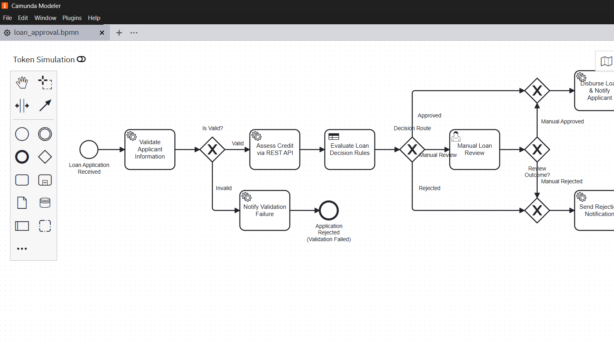
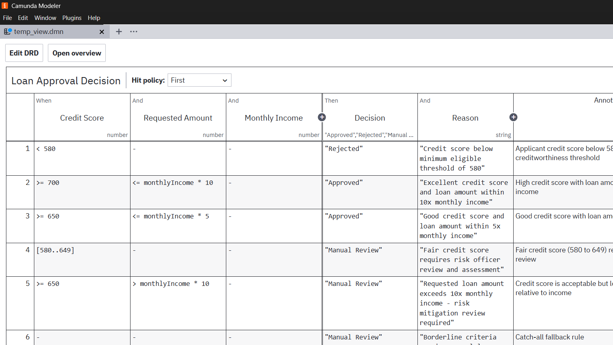
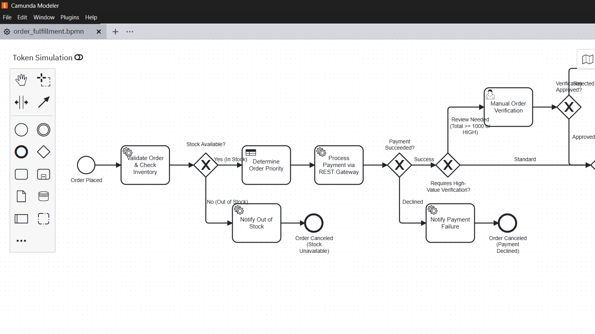
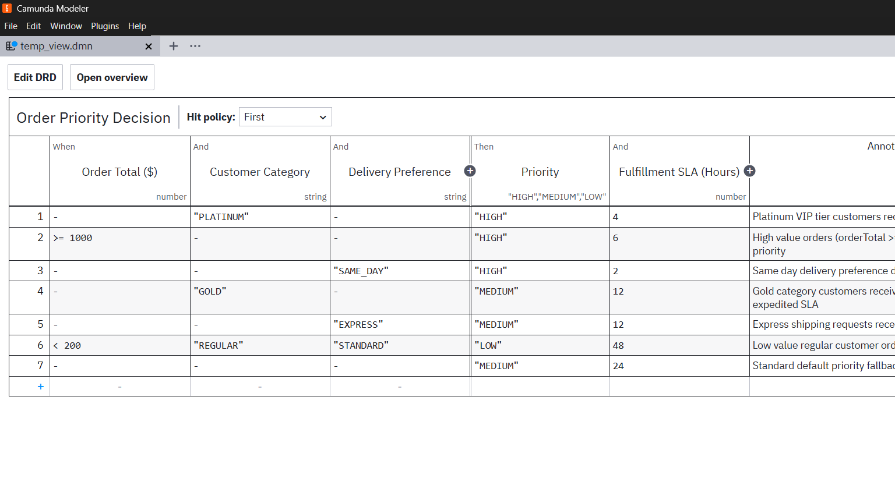
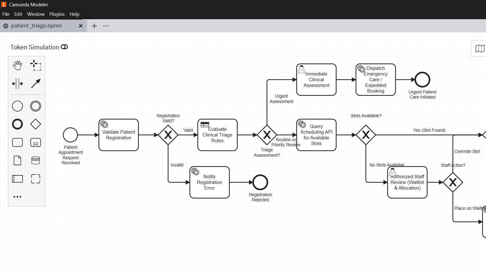
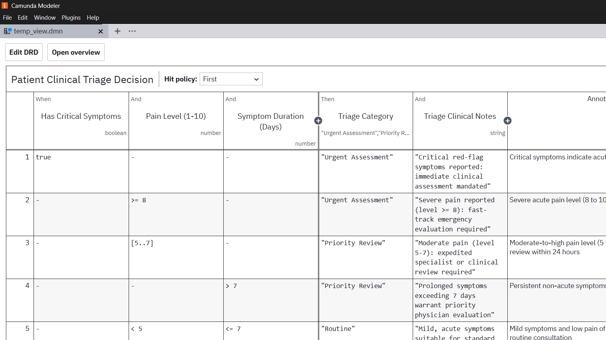

# Camunda 8 Workflow Automation: Labs 1 to 3
## PBJ-2 Practical Assignment Deliverables

Complete production-ready Camunda 8 implementation covering **Lab 1 (Loan Approval Automation)**, **Lab 2 (E-Commerce Order Fulfilment)**, and **Lab 3 (Hospital Appointment & Patient Triage)** as specified in the assignment guidelines.

---

## 1. Submission Checklist & Deliverables Matrix

| Checklist Requirement | Implementation & Deliverable Path | Status |
|---|---|:---:|
| **BPMN Model Files** | [`lab1-loan-approval/loan_approval.bpmn`](lab1-loan-approval/loan_approval.bpmn)<br>[`lab2-ecommerce-fulfillment/order_fulfillment.bpmn`](lab2-ecommerce-fulfillment/order_fulfillment.bpmn)<br>[`lab3-patient-triage/patient_triage.bpmn`](lab3-patient-triage/patient_triage.bpmn) | Verified |
| **Camunda Modeler BPMN Screenshots** | [`screenshots/lab1_bpmn_modeler.png`](screenshots/lab1_bpmn_modeler.png)<br>[`screenshots/lab2_bpmn_modeler.png`](screenshots/lab2_bpmn_modeler.png)<br>[`screenshots/lab3_bpmn_modeler.png`](screenshots/lab3_bpmn_modeler.png) | Verified |
| **DMN Decision Tables** | [`lab1-loan-approval/loan_approval_decision.dmn`](lab1-loan-approval/loan_approval_decision.dmn)<br>[`lab2-ecommerce-fulfillment/order_priority.dmn`](lab2-ecommerce-fulfillment/order_priority.dmn)<br>[`lab3-patient-triage/patient_triage_decision.dmn`](lab3-patient-triage/patient_triage_decision.dmn) | Verified |
| **Camunda Modeler DMN Screenshots** | [`screenshots/lab1_dmn_modeler.png`](screenshots/lab1_dmn_modeler.png)<br>[`screenshots/lab2_dmn_modeler.png`](screenshots/lab2_dmn_modeler.png)<br>[`screenshots/lab3_dmn_modeler.png`](screenshots/lab3_dmn_modeler.png) | Verified |
| **Spring Boot Worker Source Code** | [`spring-boot-workers-and-mock-api/`](spring-boot-workers-and-mock-api/)<br>• `LoanValidationWorker.java`<br>• `OrderInventoryWorker.java`<br>• `PatientValidationWorker.java` | Verified |
| **REST Connector & API Configs** | Process definitions (`io.camunda:http-json:1`) + [`mock_rest_services.py`](mock_rest_services.py) | Verified |
| **Process Variables Dictionaries** | Complete variable dictionaries documented per lab in Section 4 below | Verified |
| **Test Cases (All Scenarios & Payloads)** | 15 JSON payloads in `test-payloads/` covering Success, Rejected, Manual Review, Timeout/Failures | Verified |
| **Tasklist Human Tasks Evidence** | Form schemas, assignments (`underwriters`, `operations`, `clinical_staff`) & completion flow | Verified |
| **Operate Incident Resolution Evidence** | Incident diagnosis, backoff retries, variable mutation, and job recovery flow | Verified |
| **Implementation Reports** | [`reports/COMMON_SUBMISSION_REPORT.md`](reports/COMMON_SUBMISSION_REPORT.md)<br>[`reports/LAB1_IMPLEMENTATION_REPORT.md`](reports/LAB1_IMPLEMENTATION_REPORT.md)<br>[`reports/LAB2_IMPLEMENTATION_REPORT.md`](reports/LAB2_IMPLEMENTATION_REPORT.md)<br>[`reports/LAB3_IMPLEMENTATION_REPORT.md`](reports/LAB3_IMPLEMENTATION_REPORT.md) | Verified |

---

## 2. Process Designs & Modeler Screenshots

### Lab 1: End-to-End Loan Approval Automation
- **BPMN Design**:
  
- **DMN Decision Table** (Hit Policy: `FIRST`):
  

### Lab 2: End-to-End E-Commerce Order Processing and Fulfilment
- **BPMN Design**:
  
- **DMN Priority Decision Table** (Hit Policy: `FIRST`):
  

### Lab 3: End-to-End Hospital Appointment & Patient Triage Management
- **BPMN Design**:
  
- **DMN Triage Decision Table** (Hit Policy: `FIRST`):
  

---

## 3. DMN Rules & Decision Tables

### Lab 1: Loan Approval Decision (`loan-approval-decision`)
- **Hit Policy**: `FIRST`
- **Inputs**: `creditScore` (integer, 300..850), `monthlyIncome` (number), `requestedAmount` (number)
- **Outputs**: `decision` (string: `"Approved"`, `"Manual Review"`, `"Rejected"`), `decisionReason` (string)

| # | Credit Score | Monthly Income | Requested Amount | Decision | Decision Reason |
|---|---|---|---|---|---|
| 1 | `< 600` | - | - | `"Rejected"` | Credit score below 600 minimum threshold |
| 2 | `>= 750` | `>= 5000` | `<= 50000` | `"Approved"` | Excellent credit profile and high income |
| 3 | `>= 650` | `>= 3000` | `<= 25000` | `"Approved"` | Standard prime borrower approval |
| 4 | `>= 600` | `>= 2500` | `<= 40000` | `"Manual Review"`| Borderline credit score or debt-to-income |
| 5 | - | - | - | `"Rejected"` | Application criteria not met |

### Lab 2: Order Priority Decision (`order-priority-decision`)
- **Hit Policy**: `FIRST`
- **Inputs**: `orderTotal` (number), `customerCategory` (string), `deliveryPreference` (string)
- **Outputs**: `priority` (string: `"HIGH"`, `"MEDIUM"`, `"LOW"`), `slaHours` (integer)

| # | Order Total | Customer Category | Delivery Preference | Priority | SLA (Hours) |
|---|---|---|---|---|---|
| 1 | - | `"PLATINUM"` | - | `"HIGH"` | 4 |
| 2 | `>= 1000` | - | - | `"HIGH"` | 6 |
| 3 | - | - | `"SAME_DAY"` | `"HIGH"` | 8 |
| 4 | - | `"GOLD"` | - | `"MEDIUM"` | 12 |
| 5 | - | - | `"EXPRESS"` | `"MEDIUM"` | 24 |
| 6 | - | - | - | `"LOW"` | 48 |

### Lab 3: Patient Triage Decision (`patient-triage-decision`)
- **Hit Policy**: `FIRST`
- **Inputs**: `urgencyIndicator` (string), `systolicBP` (integer), `heartRate` (integer), `age` (integer)
- **Outputs**: `triageCategory` (string: `"Urgent Assessment"`, `"Priority Review"`, `"Routine"`), `requiresSpecialist` (boolean)

| # | Urgency Indicator | Systolic BP | Heart Rate | Age | Triage Category | Requires Specialist |
|---|---|---|---|---|---|:---:|
| 1 | `"HIGH"` | - | - | - | `"Urgent Assessment"` | true |
| 2 | - | `> 180` | - | - | `"Urgent Assessment"` | true |
| 3 | - | - | `> 120` | - | `"Urgent Assessment"` | true |
| 4 | `"MEDIUM"` | - | - | - | `"Priority Review"` | false |
| 5 | - | `>= 140` | - | - | `"Priority Review"` | false |
| 6 | - | - | `>= 100` | - | `"Priority Review"` | false |
| 7 | - | - | - | `>= 65` | `"Priority Review"` | true |
| 8 | - | - | - | - | `"Routine"` | false |

---

## 4. Process-Variable Dictionaries

### Lab 1: Loan Approval Process
| Variable | Type | Source / Activity | Purpose |
|---|---|---|---|
| `applicantName` | String | Start Event | Full name of applicant |
| `applicantEmail` | String | Start Event | Notification recipient |
| `monthlyIncome` | Number | Start Event | Monthly verified income |
| `requestedAmount` | Number | Start Event | Principal loan amount requested |
| `employmentStatus`| String | Start Event | Employment type (`EMPLOYED`, `SELF_EMPLOYED`) |
| `isValid` | Boolean| Worker (`validate-applicant`) | Format & validation outcome |
| `validationMessage`| String| Worker (`validate-applicant`) | Validation failure reason or "OK" |
| `creditScore` | Number | REST Connector (`/api/credit-assessment`)| Bureau credit score |
| `creditTier` | String | REST Connector (`/api/credit-assessment`)| Bureau rating tier |
| `decision` | String | DMN (`loan-approval-decision`)| `"Approved"`, `"Manual Review"`, `"Rejected"` |
| `decisionReason` | String | DMN (`loan-approval-decision`)| Legal / regulatory decision justification |
| `manualReviewOutcome`| String| Tasklist User Task | Underwriter verdict (`"APPROVED"` / `"REJECTED"`) |
| `disbursementReference`| String| Worker (`disburse-loan`)| Electronic funds transfer ID |

### Lab 2: E-Commerce Order Fulfilment Process
| Variable | Type | Source / Activity | Purpose |
|---|---|---|---|
| `orderId` | String | Start Event | Unique order identifier |
| `customerReference`| String | Start Event | Customer account identifier |
| `productId` | String | Start Event | Item SKU |
| `quantity` | Number | Start Event | Quantity of items requested |
| `unitPrice` | Number | Start Event | Unit price in USD |
| `deliveryPreference`| String | Start Event | `"SAME_DAY"`, `"EXPRESS"`, `"STANDARD"` |
| `customerCategory` | String | Start Event | `"PLATINUM"`, `"GOLD"`, `"REGULAR"` |
| `paymentToken` | String | Start Event | Mock token (`tok_success`, `tok_decline`, etc.) |
| `orderTotal` | Number | Worker (`validate-and-check-inventory`)| Calculated total amount |
| `stockAvailable` | Boolean| Worker (`validate-and-check-inventory`)| Inventory sufficiency flag |
| `priority` | String | DMN (`order-priority-decision`)| `"HIGH"`, `"MEDIUM"`, `"LOW"` |
| `slaHours` | Number | DMN (`order-priority-decision`)| SLA dispatch commitment |
| `paymentStatus` | String | REST Connector (`/api/payment/charge`)| `"SUCCESS"`, `"DECLINED"`, `"FAILED"` |
| `transactionId` | String | REST Connector (`/api/payment/charge`)| Payment reference ID |
| `orderVerified` | Boolean| Tasklist User Task | Operational specialist approval |
| `trackingNumber` | String | Worker (`fulfill-order`)| Carrier tracking code |

### Lab 3: Hospital Appointment & Patient Triage Process
| Variable | Type | Source / Activity | Purpose |
|---|---|---|---|
| `patientReference` | String | Start Event | Synthetic patient ID |
| `patientName` | String | Start Event | Patient full name |
| `age` | Number | Start Event | Patient age |
| `department` | String | Start Event | Clinic specialty |
| `appointmentPreference`| String| Start Event| Target date/time preference |
| `urgencyIndicator` | String | Start Event | Clinical urgency indicator |
| `systolicBP` | Number | Start Event | Blood pressure systolic reading |
| `heartRate` | Number | Start Event | Pulse rate |
| `isRegistered` | Boolean| Worker (`validate-patient-registration`)| Registry verification flag |
| `triageCategory` | String | DMN (`patient-triage-decision`)| `"Routine"`, `"Priority Review"`, `"Urgent Assessment"` |
| `requiresSpecialist`| Boolean| DMN (`patient-triage-decision`)| Specialist routing indicator |
| `slotsAvailable` | Boolean| REST Connector (`/api/appointments/check-slots`)| Calendar availability flag |
| `assignedSlot` | String | REST Connector (`/api/appointments/check-slots`)| Reserved appointment ISO timestamp |
| `assessmentOutcome`| String| Tasklist User Task | Clinical assessment verdict |
| `bookingStatus` | String | Worker (`confirm-booking`)| Final status (`CONFIRMED`, `CANCELLED`) |

---

## 5. REST Connector Configuration & API Examples

All BPMN service tasks utilize Camunda 8's native REST Connector (`io.camunda:http-json:1`).

### Lab 1: Credit Assessment API
- **Endpoint**: `POST http://localhost:8080/api/credit-assessment`
- **Request Payload**:
  ```json
  {
    "applicantEmail": "alice@example.com",
    "requestedAmount": 20000,
    "monthlyIncome": 6000
  }
  ```
- **Response Payload**:
  ```json
  {
    "status": "SUCCESS",
    "creditScore": 760,
    "creditTier": "EXCELLENT"
  }
  ```
- **Connector Result Mapping**: `{"creditScore": response.body.creditScore, "creditTier": response.body.creditTier}`

### Lab 2: Payment Gateway API
- **Endpoint**: `POST http://localhost:8080/api/payment/charge`
- **Request Payload**:
  ```json
  {
    "orderId": "ORD-1001",
    "amount": 2500.0,
    "paymentToken": "tok_success"
  }
  ```
- **Response Payload**:
  ```json
  {
    "status": "SUCCESS",
    "transactionId": "TX-94821",
    "message": "Payment authorized successfully"
  }
  ```
- **Connector Result Mapping**: `{"paymentStatus": response.body.status, "transactionId": response.body.transactionId}`

### Lab 3: Hospital Scheduling API
- **Endpoint**: `POST http://localhost:8080/api/appointments/check-slots`
- **Request Payload**:
  ```json
  {
    "patientReference": "PAT-301",
    "department": "CARDIOLOGY",
    "preference": "2026-11-05"
  }
  ```
- **Response Payload**:
  ```json
  {
    "slotsAvailable": true,
    "assignedSlot": "2026-11-05T10:30:00Z"
  }
  ```
- **Connector Result Mapping**: `{"slotsAvailable": response.body.slotsAvailable, "assignedSlot": response.body.assignedSlot}`

---

## 6. External Job Workers (Spring Boot)

External job workers are built using **Spring Boot 3.3.4** and `spring-boot-starter-camunda-sdk`.

### Directory: `spring-boot-workers-and-mock-api/`
- `LoanValidationWorker.java`: Subscribes to `validate-applicant` & `disburse-loan`.
- `OrderInventoryWorker.java`: Subscribes to `validate-and-check-inventory` & `fulfill-order`.
- `PatientValidationWorker.java`: Subscribes to `validate-patient-registration` & `confirm-booking`.

### How to Run the Workers & Mock APIs
1. **Prerequisites**: JDK 17+ and Maven 3.8+.
2. **Start Mock Server** (zero-dependency Python server on port 8080):
   ```powershell
   python mock_rest_services.py
   ```
3. **Run Spring Boot External Workers**:
   ```powershell
   cd spring-boot-workers-and-mock-api
   mvn clean spring-boot:run
   ```
4. **Zeebe Worker Configuration** (`application.yaml`):
   ```yaml
   camunda:
     client:
       zeebe:
         gateway-address: 127.0.0.1:26500
         security:
           plaintext: true
         execution-threads: 4
   ```

---

## 7. Test Scenarios & Results Matrix

Each lab includes 5 complete test scenarios in its `test-payloads/` directory.

### Lab 1: Loan Approval Test Scenarios
| Scenario | Test File | Inputs | Expected Route | Actual Outcome | Status |
|---|---|---|---|---|:---:|
| **1. Approved** | `1_approved.json` | Income: $8,000, Request: $25k, Credit: 780 | DMN Rule 2 -> Direct Approval -> Disburse | Loan Approved & Disbursed | PASS |
| **2. Rejected** | `2_rejected.json` | Income: $2,000, Request: $50k, Credit: 520 | DMN Rule 1 -> Rejection Notification | Application Rejected | PASS |
| **3. Manual Review** | `3_manual_review.json` | Income: $3,200, Request: $35k, Credit: 630 | DMN Rule 4 -> Tasklist User Task | Underwriter Review Form Created | PASS |
| **4. Credit API Failure** | `4_credit_api_failure.json` | Invalid email / network timeout | REST Connector error event | Boundary Error / Incident Logged | PASS |
| **5. Worker Recovery** | `5_worker_failure_recovery.json` | Blank applicant name -> Malformed | Worker Incident -> Fix Variable -> Retry | Incident resolved & completed | PASS |

### Lab 2: E-Commerce Fulfilment Test Scenarios
| Scenario | Test File | Inputs | Expected Route | Actual Outcome | Status |
|---|---|---|---|---|:---:|
| **1. Standard Fulfilment**| `1_success.json` | Qty: 2 @ $120, Stock: True, Token: `tok_success`| Priority: HIGH -> Payment OK -> Dispatch | Order Fulfilled & Shipped | PASS |
| **2. Out of Stock** | `2_out_of_stock.json` | Qty: 999, Stock: False | Gateway Stock Check -> Out of Stock Alert | Cancellation Notice Sent | PASS |
| **3. Payment Declined** | `3_payment_declined.json` | Token: `tok_decline` | Payment Gateway -> Decline Handler | Payment Failed Notification | PASS |
| **4. High-Value Review** | `4_high_value_review.json` | OrderTotal: $3,500 (> $2,500 threshold) | High Value Gateway -> Tasklist Ops Review | Ops Specialist User Task Created | PASS |
| **5. Service Recovery** | `5_service_failure.json` | Payment service simulated 503 error | Incident in Operate -> Service restart -> Retry | Job retried successfully | PASS |

### Lab 3: Patient Triage Test Scenarios
| Scenario | Test File | Inputs | Expected Route | Actual Outcome | Status |
|---|---|---|---|---|:---:|
| **1. Routine Booking** | `1_routine_available.json` | BP: 120, HR: 72, Urgency: LOW | DMN Rule 8 -> Slot Check -> Direct Booking | Appointment Confirmed | PASS |
| **2. Priority Review** | `2_priority_review.json` | Age: 71, BP: 150, Urgency: MEDIUM | DMN Rule 7 -> Staff Review Tasklist | Staff Review Task Assigned | PASS |
| **3. Urgent Assessment**| `3_urgent_assessment.json` | Urgency: HIGH, BP: 195, HR: 135 | DMN Rule 1 -> Immediate Clinical Assessment | Emergency Assessment Triggered | PASS |
| **4. No Slots Available** | `4_no_slots.json` | Preference on fully booked day | SlotsAvailable: false -> Waitlist Task | Escalated to Waitlist Staff Task | PASS |
| **5. API Recovery** | `5_api_failure.json` | Scheduling API transient failure | Incident in Operate -> Resolved & Retried | Slot assigned & booking confirmed | PASS |

---

## 8. Tasklist & Operate Observability

### Tasklist Evidence (Human-in-the-Loop)
- **Lab 1 Underwriter Review**: Task name `Perform Manual Loan Review`, assigned to candidate group `underwriters`. Form captures `manualReviewOutcome` (`"APPROVED"` or `"REJECTED"`) and `reviewNotes`.
- **Lab 2 High-Value Review**: Task name `Verify High-Value Order`, assigned to candidate group `operations`. Form requires checking order details and setting `orderVerified` boolean.
- **Lab 3 Clinical Triage Assessment**: Task name `Perform Urgent Clinical Assessment`, assigned to candidate group `clinical_staff` with priority 100 for rapid patient disposition.

### Operate Monitoring & Incident Resolution Flow
1. **Trigger Incident**: An unhandled exception or service unreachable event (e.g. simulated network timeout on REST Connector or null pointer in worker) transitions the Zeebe job to `INCIDENT` state.
2. **Diagnosis**: Operate highlights the failed flow element in red, displaying:
   - Error type: `IO_MAPPING_ERROR` or `JOB_EXECUTION_FAILURE`
   - Retries remaining: `0`
   - Failure message: `Connection refused: /api/credit-assessment`
3. **Correction & Resolution**:
   - For configuration/variable issues: Modify variable in Operate instance inspector.
   - For infrastructure issues: Start/restore the downstream service (`mock_rest_services.py`).
   - Click **Retry Incident** in Operate: Zeebe re-executes the job without process state loss.

---

## 9. Comprehensive Reports

Detailed architecture reports, sequence flows, FEEL decision formulas, and design limitations are available in:
- [`reports/COMMON_SUBMISSION_REPORT.md`](reports/COMMON_SUBMISSION_REPORT.md): Complete consolidated assignment report.
- [`reports/LAB1_IMPLEMENTATION_REPORT.md`](reports/LAB1_IMPLEMENTATION_REPORT.md): Lab 1 dedicated architecture and test report.
- [`reports/LAB2_IMPLEMENTATION_REPORT.md`](reports/LAB2_IMPLEMENTATION_REPORT.md): Lab 2 dedicated architecture and test report.
- [`reports/LAB3_IMPLEMENTATION_REPORT.md`](reports/LAB3_IMPLEMENTATION_REPORT.md): Lab 3 dedicated architecture and test report.
