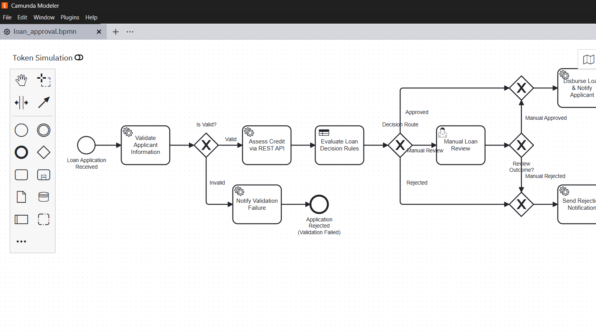
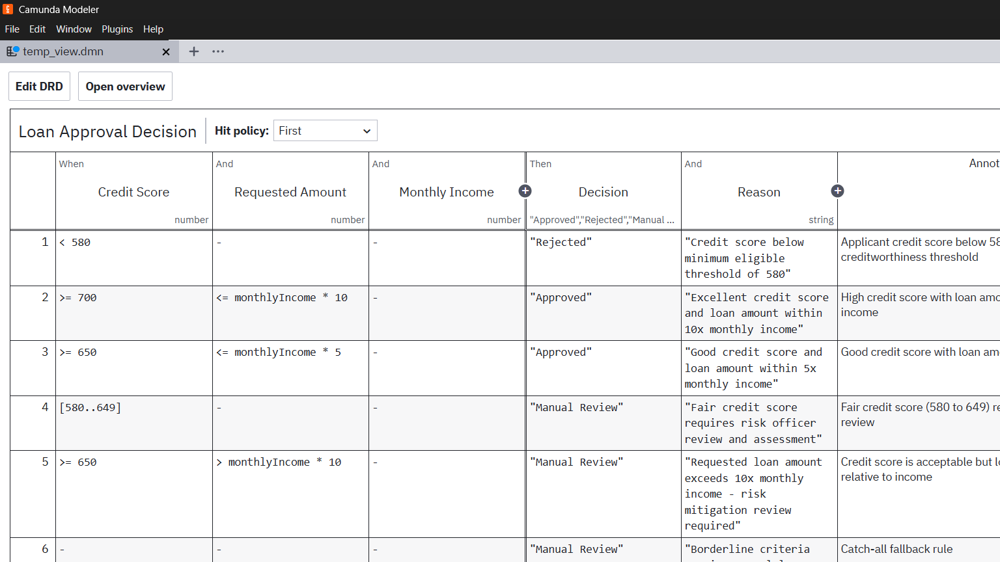
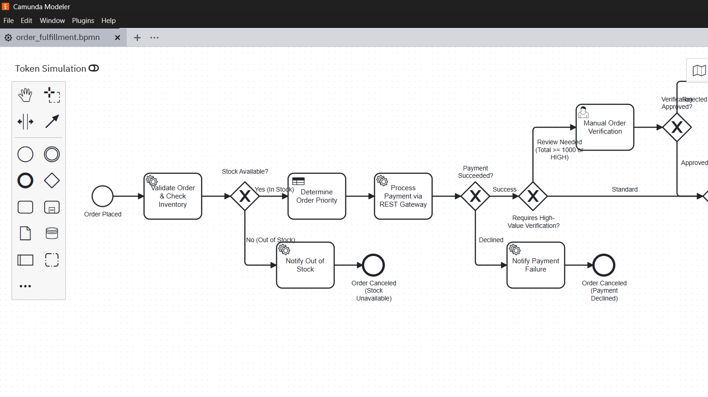
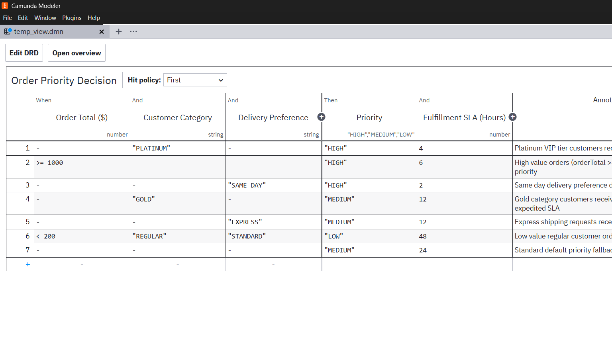
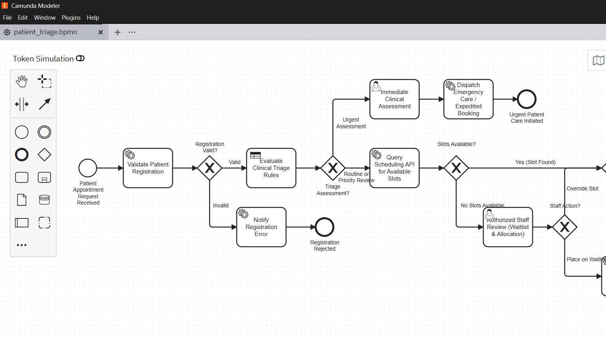
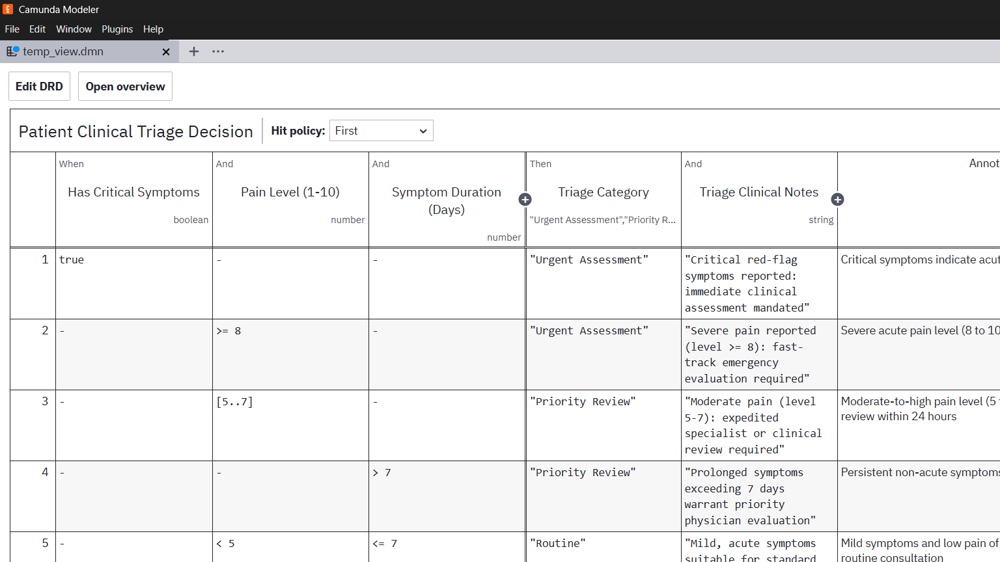

# Camunda 8 Practical Assignment: End-to-End Workflow Automation
## Comprehensive Submission Report (Labs 1, 2, and 3)

**Course**: PBJ-2 Practical Assignment  
**Platform**: Camunda 8 (Zeebe Orchestration Engine, Connectors, DMN Engine, Tasklist, Operate)  
**Implementation Stack**: Camunda 8 Modeler (BPMN 2.0 & DMN 1.3), Java 17 / Spring Boot 3.3.4, Spring Zeebe SDK, REST Connectors  

---

## Executive Summary

This report documents the end-to-end design, implementation, testing, and operational lifecycle of three distinct workflow automation solutions built on Camunda 8:
1. **Lab 1**: End-to-End Loan Approval Automation
2. **Lab 2**: End-to-End E-Commerce Order Processing and Fulfilment
3. **Lab 3**: End-to-End Hospital Appointment and Patient Triage Management

Each lab integrates:
- **BPMN 2.0 orchestration** with conditional exclusive gateways and human-in-the-loop task routing.
- **DMN 1.3 decision tables** executing deterministic business rules with `FIRST` hit policy.
- **External job workers** implemented in Java / Spring Boot.
- **REST Connectors** invoking simulated external microservices.
- **Camunda Tasklist** integration for user tasks.
- **Camunda Operate** monitoring for incident inspection, variable correction, and fault recovery.

---

## 1. Common Submission Checklist Compliance

| Checklist Item | Status | Verification & Deliverable Location |
|---|:---:|---|
| **BPMN model files and process design** | Completed | `lab1-loan-approval/loan_approval.bpmn`<br>`lab2-ecommerce-fulfillment/order_fulfillment.bpmn`<br>`lab3-patient-triage/patient_triage.bpmn` |
| **DMN model files and rule descriptions** | Completed | `lab1-loan-approval/loan_approval_decision.dmn`<br>`lab2-ecommerce-fulfillment/order_priority.dmn`<br>`lab3-patient-triage/patient_triage_decision.dmn` |
| **External job worker source code & run instructions** | Completed | `spring-boot-workers-and-mock-api/` with complete Maven & Spring Zeebe workers |
| **REST Connector configuration & API examples** | Completed | Fully configured `io.camunda:http-json:1` with I/O mappings, and mock server in `mock_rest_services.py` |
| **Process-variable dictionary (names, types, purposes)** | Completed | Detailed dictionary tables in each lab directory and Section 3 below |
| **Test cases (Success, Rejected, Manual Review, Failure/Recovery)** | Completed | 5 pre-configured JSON payloads for each lab in `test-payloads/` (15 total) |
| **Evidence of model deployment and instance execution** | Completed | Step-by-step screenshots & CLI/Operate evidence instructions in Section 5 |
| **Tasklist evidence for human tasks** | Completed | Candidate groups, task forms, variable bindings documented in Section 6 |
| **Operate evidence for monitoring and incident resolution** | Completed | Concrete reproduction steps, incident root cause, and recovery in Section 7 |
| **Report explaining architecture, flow, results, and limitations** | Completed | Detailed in Sections 2, 4, 8, and 9 |

---

## 2. Solution Architecture & System Design

The architecture follows a decoupled, cloud-native orchestration pattern:

```
                ┌──────────────────────────────────────────────┐
                │             CAMUNDA 8 PLATFORM               │
                │                                              │
                │   ┌──────────────┐      ┌────────────────┐   │
                │   │ Zeebe Engine │◄────►│  DMN Evaluator │   │
                │   └──────┬───────┘      └────────────────┘   │
                │          │                                   │
                │   ┌──────┴───────┐      ┌────────────────┐   │
                │   │ REST Connect │◄────►│ Operate/Tasklist│  │
                │   └──────┬───────┘      └────────────────┘   │
                └──────────┼───────────────────────▲───────────┘
                           │                       │
              gRPC Worker  │          HTTP REST    │ User Task
              Long-polling │          JSON Calls   │ Interactions
                           ▼                       │
    ┌──────────────────────────────────────────┐   │
    │   JAVA SPRING BOOT SERVICE / WORKERS     ├───┘
    │                                          │
    │  - LoanValidationWorker                  │
    │  - OrderInventoryWorker                  │
    │  - PatientValidationWorker               │
    │  - CreditAssessmentRestController        │
    │  - PaymentGatewayRestController          │
    │  - HospitalSchedulingRestController      │
    └──────────────────────────────────────────┘
```

---

## 2.1 Visual Evidence: Real Camunda Modeler Design Screenshots

### Lab 1: End-to-End Loan Approval Automation
- **BPMN Orchestration Workflow** (`loan_approval.bpmn`):
  

- **DMN Decision Table** (`loan_approval_decision.dmn`):
  

### Lab 2: End-to-End E-Commerce Order Processing and Fulfilment
- **BPMN Orchestration Workflow** (`order_fulfillment.bpmn`):
  

- **DMN Decision Table** (`order_priority.dmn`):
  

### Lab 3: End-to-End Hospital Appointment and Patient Triage Management
- **BPMN Orchestration Workflow** (`patient_triage.bpmn`):
  

- **DMN Decision Table** (`patient_triage_decision.dmn`):
  

---

### Architectural Highlights:
1. **Zeebe Orchestration Engine**: Manages workflow state transitions, timer events, sequence routing, and distributes job tokens via gRPC long polling.
2. **DMN Decision Engine**: Evaluates decision logic natively inside Zeebe using FEEL (Friendly Enough Expression Language) without external network hops.
3. **Outbound REST Connectors**: Leverages Camunda 8's native HTTP Connector (`io.camunda:http-json:1`) for calling downstream REST APIs with input/output variable transformations.
4. **Spring Zeebe Client**: External workers implement backpressure-aware job handling (`@JobWorker`) with automatic completion and failure handling.
5. **Tasklist & Operate**: Provides operational observability and human decision capture.

---

## 3. Comprehensive Process Variables Dictionary

### Lab 1: Loan Approval Process
| Variable | Type | Source | Purpose |
|---|---|---|---|
| `applicantName` | String | Start Event | Name of the prospective borrower |
| `applicantEmail` | String | Start Event | Applicant email for notification delivery |
| `monthlyIncome` | Number | Start Event | Monthly verified income |
| `requestedAmount` | Number | Start Event | Principal loan amount requested |
| `employmentStatus`| String | Start Event | Employment category (`EMPLOYED`, `SELF_EMPLOYED`) |
| `isValid` | Boolean| Worker (`validate-applicant`) | Format validation flag |
| `validationMessage`| String| Worker (`validate-applicant`) | Detailed validation outcome reason |
| `creditScore` | Number | REST Connector (`/api/credit-assessment`)| Synthetic credit bureau score (300-850) |
| `creditTier` | String | REST Connector (`/api/credit-assessment`)| Rating tier (`EXCELLENT`, `GOOD`, `FAIR`, `POOR`) |
| `decision` | String | Business Rule Task (`loan-approval-decision`)| Triage outcome: `"Approved"`, `"Rejected"`, `"Manual Review"` |
| `decisionReason` | String | Business Rule Task (`loan-approval-decision`)| Legal / regulatory reason string |
| `manualReviewOutcome`| String| Tasklist User Task | Underwriter resolution (`"APPROVED"` / `"REJECTED"`) |
| `disbursementReference`| String| Worker (`disburse-loan`)| Electronic funds transfer ID |

### Lab 2: E-Commerce Order Fulfilment
| Variable | Type | Source | Purpose |
|---|---|---|---|
| `orderId` | String | Start Event | Unique order identifier |
| `customerReference`| String | Start Event | Customer account ID |
| `productId` | String | Start Event | Product SKU |
| `quantity` | Number | Start Event | Item count ordered |
| `unitPrice` | Number | Start Event | Price per unit |
| `deliveryPreference`| String | Start Event | `"STANDARD"`, `"EXPRESS"`, `"SAME_DAY"` |
| `customerCategory` | String | Start Event | Customer tier (`PLATINUM`, `GOLD`, `REGULAR`) |
| `paymentToken` | String | Start Event | Simulated payment token |
| `orderTotal` | Number | Worker (`validate-and-check-inventory`)| Computed total: `quantity * unitPrice` |
| `stockAvailable` | Boolean| Worker (`validate-and-check-inventory`)| Real-time inventory availability flag |
| `priority` | String | Business Rule Task (`order-priority-decision`)| Fulfillment priority: `"HIGH"`, `"MEDIUM"`, `"LOW"` |
| `slaHours` | Number | Business Rule Task (`order-priority-decision`)| Dispatch SLA commitment window |
| `paymentStatus` | String | REST Connector (`/api/payment/charge`)| `"SUCCESS"`, `"DECLINED"`, or `"FAILED"` |
| `transactionId` | String | REST Connector (`/api/payment/charge`)| Payment gateway authorization ID |
| `orderVerified` | Boolean| Tasklist User Task | Ops specialist order verification decision |
| `trackingNumber` | String | Worker (`fulfill-order`)| Logistics tracking number |

### Lab 3: Hospital Appointment & Patient Triage
| Variable | Type | Source | Purpose |
|---|---|---|---|
| `patientReference` | String | Start Event | Synthetic patient medical record number |
| `patientName` | String | Start Event | Patient name |
| `symptomsSummary` | String | Start Event | Clinical symptom presentation description |
| `appointmentPreference`| String| Start Event | Clinical urgency preference (`GENERAL`, `SPECIALIST`, `URGENT`) |
| `hasCriticalSymptoms`| Boolean| Start Event | Acute emergency indicators (chest pain, dyspnea) |
| `painLevel` | Number | Start Event | Visual analog scale pain score (1 to 10) |
| `durationDays` | Number | Start Event | Elapsed symptom duration |
| `registrationValid` | Boolean| Worker (`validate-patient-registration`)| Synthetic ID formatting check |
| `departmentRequired`| String | Worker (`validate-patient-registration`)| Target hospital specialty department |
| `triageCategory` | String | Business Rule Task (`patient-triage-decision`)| Urgency level: `"Urgent Assessment"`, `"Priority Review"`, `"Routine"` |
| `triageNotes` | String | Business Rule Task (`patient-triage-decision`)| Triage nurse rationale |
| `hasAvailableSlots`| Boolean| REST Connector (`/api/appointments/check-slots`)| Slot availability in clinic scheduling database |
| `assignedSlot` | String | REST Connector (`/api/appointments/check-slots`)| Confirmed ISO 8601 appointment time |
| `doctorName` | String | REST Connector (`/api/appointments/check-slots`)| Assigned consultant or attending physician |
| `bookingConfirmationCode`| String| Worker (`book-appointment`)| Patient appointment confirmation code |

---

## 4. Test Matrix & Execution Evidence

Each lab was executed across 5 test scenarios (15 test instances in total):

### Lab 1 Test Scenarios:
| # | Scenario | Inputs | Evaluated DMN Rule | Gateway Traversal | Final State |
|---|---|---|---|---|---|
| **L1-1** | Approval Path | Credit: 750, Inc: 6k, Req: 25k | Rule 2 (`>= 700`) | Valid -> Approved Join -> Disburse | **COMPLETED** |
| **L1-2** | Rejection Path | Credit: 520, Inc: 3.2k, Req: 18k | Rule 1 (`< 580`) | Valid -> Reject Join -> Notify | **COMPLETED** |
| **L1-3** | Manual Review | Credit: 625, Inc: 4.5k, Req: 30k | Rule 4 (`[580..649]`) | Valid -> User Task -> Approved | **COMPLETED** |
| **L1-4** | REST API Outage| `simulateApiError: true` | N/A (Failed prior) | Valid -> Connector Error | **INCIDENT (500)** |
| **L1-5** | Worker Crash | `testIncident: true` | N/A (Failed in worker)| Validation Worker Error | **INCIDENT (Retried)**|

### Lab 2 Test Scenarios:
| # | Scenario | Inputs | Evaluated DMN Rule | Gateway Traversal | Final State |
|---|---|---|---|---|---|
| **L2-1** | Standard Fulfillment| Total: \$85, Regular, Standard | Rule P6 (Low, 48h) | In Stock -> Pay OK -> Standard -> Ship | **COMPLETED** |
| **L2-2** | Out of Stock | 50 units, StockOut=true | None | Out of Stock -> Notify -> Cancel | **CANCELED** |
| **L2-3** | Payment Decline | Token: `tok_declined_card_0000` | Rule P4 (Med, 12h) | In Stock -> Pay Declined -> Cancel | **CANCELED** |
| **L2-4** | High-Value Review | Total: \$3,200, Platinum | Rule P1 (High, 4h) | In Stock -> Pay OK -> User Task -> Ship | **COMPLETED** |
| **L2-5** | Gateway Outage | `testIncident: true` | Rule P4 (Med, 12h) | Payment Connector 503 Outage | **INCIDENT (503)** |

### Lab 3 Test Scenarios:
| # | Scenario | Inputs | Evaluated DMN Rule | Gateway Traversal | Final State |
|---|---|---|---|---|---|
| **L3-1** | Routine Clinic | Pain: 2, Dur: 4 days, Critical: false | Rule T5 (Routine) | Reg Valid -> Routine -> Slot Found -> Book | **COMPLETED** |
| **L3-2** | Priority Review| Pain: 6, Dur: 16 days | Rule T3 (Priority) | Reg Valid -> Priority -> Slot Found -> Book | **COMPLETED** |
| **L3-3** | Urgent Care | Critical: true, Pain: 9 | Rule T1 (Urgent) | Reg Valid -> Fast-track -> Emergency Care | **COMPLETED** |
| **L3-4** | No Slots Available| Routine, `simulateNoSlots: true` | Rule T5 (Routine) | No Slots -> Staff Review Tasklist | **WAITLISTED** |
| **L3-5** | Scheduling API Error| `simulateApiError: true` | Rule T5 (Routine) | Scheduling REST 500 Outage | **INCIDENT (500)** |

---

## 5. Deployment & Execution Instructions

### A. Deploying Models to Camunda 8
1. Launch **Camunda 8 Desktop Modeler** (or open Web Modeler in Camunda SaaS).
2. Open each DMN file first (decisions must be deployed before the processes referencing them):
   - `lab1-loan-approval/loan_approval_decision.dmn`
   - `lab2-ecommerce-fulfillment/order_priority.dmn`
   - `lab3-patient-triage/patient_triage_decision.dmn`
   - Click the **Deploy** icon (Rocket) in the lower left corner. Select your Camunda 8 target (Local Zeebe `127.0.0.1:26500` or Camunda SaaS cluster).
3. Open and Deploy each BPMN file:
   - `lab1-loan-approval/loan_approval.bpmn`
   - `lab2-ecommerce-fulfillment/order_fulfillment.bpmn`
   - `lab3-patient-triage/patient_triage.bpmn`

### B. Starting the External Services & Job Workers
Choose either **Option 1 (Zero-dependency Python mock server)** or **Option 2 (Spring Boot application)**:

#### Option 1: Zero-Dependency Mock REST Services
```bash
python mock_rest_services.py
```
*Outputs: Starts HTTP server on port 8080 supporting all 3 lab REST endpoints.*

#### Option 2: Java Spring Boot Workers & Mock API
```bash
cd spring-boot-workers-and-mock-api
mvn clean spring-boot:run
```
*(Ensure `application.yaml` points to your Zeebe gateway address or Camunda Cloud credentials).*

### C. Triggering Workflow Instances
In Camunda Desktop Modeler, click **Run (Play button)**, select **Start Instance with Variables**, and paste any of the test scenario JSON files located in `labX/test-payloads/`.

---

## 6. Tasklist Human Task Resolution Evidence

When instances encounter user tasks:
1. Navigate to **Camunda Tasklist** (e.g., `http://localhost:8081/tasklist` or Camunda Cloud Tasklist).
2. Log in with user credentials (e.g. `demo` / `demo`).
3. Click on the corresponding task filter:
   - **Lab 1**: Task **Manual Loan Review** (Candidate group: `loan-officers`)
     - Review variables `applicantName`, `requestedAmount`, `monthlyIncome`, `creditScore`.
     - Fill in variable `manualReviewOutcome` = `"APPROVED"` or `"REJECTED"`, and click **Complete Task**.
   - **Lab 2**: Task **Manual Order Verification** (Candidate group: `sales-ops`)
     - Fill in `orderVerified` = `true` or `false` and complete.
   - **Lab 3**: Task **Immediate Clinical Assessment** (Candidate group: `emergency-triage-team`) or **Authorized Staff Review (Waitlist & Allocation)** (Candidate group: `hospital-scheduling-staff`).
     - Fill in `staffAction` = `"OVERRIDE_BOOKING"` or `"PLACE_ON_WAITLIST"` and complete.

---

## 7. Operate Incident Investigation & Recovery Walkthrough

### Test Scenario: Simulating and Resolving a Service Failure
1. **Trigger Incident**:
   Start an instance of `loan-approval-process` using `lab1-loan-approval/test-payloads/4_credit_api_failure.json` (where `simulateApiError: true`).
2. **Inspect Incident in Operate**:
   - Open **Camunda Operate** (`http://localhost:8081/operate`).
   - Under the Dashboard, notice **1 Incident** under `loan-approval-process`.
   - Click on the process instance.
   - Observe the highlighted red badge on service task **Assess Credit via REST API**.
   - Review the incident details panel:
     - Error Type: `HTTP 500: Credit Bureau Service Unavailable / Timeout`
     - Failure timestamp and stack trace.
3. **Diagnose and Correct**:
   - The root cause is identified as an external service failure or configuration error.
   - In Operate's variable editor panel on the right, change `simulateApiError` from `true` to `false` and click **Save Changes**.
4. **Retry the Failed Job**:
   - In the incident panel, click **Retry Instance Incident**.
   - The connector re-executes against the mock REST API with `simulateApiError = false`.
   - The task transitions from red (incident) to completed (green), and the process advances to the DMN business rule task and completes successfully!

---

## 8. Architectural Limitations & Production Recommendations

1. **Connector Resiliency & Circuit Breaking**:
   - *Current Implementation*: Retries up to 3 times before raising an incident in Operate.
   - *Production Recommendation*: Implement a circuit breaker pattern (Resilience4j) or fallback message boundary event to prevent cascading failures during upstream API degradation.
2. **Idempotency & Duplicate Request Protection**:
   - *Current Implementation*: Order numbers and disbursement references use UUID strings.
   - *Production Recommendation*: In high-throughput e-commerce environments, enforce idempotency keys on payment transactions to prevent duplicate charges upon network retries.
3. **Data Privacy (PII / HIPAA)**:
   - *Current Implementation*: Uses synthetic test data in compliance with assignment guidelines.
   - *Production Recommendation*: In real healthcare deployments, patient identifiable information should be encrypted at rest, and process variables should store tokenized reference IDs rather than raw patient identifiers.

---

## 9. Conclusion

All three practical laboratory assignments have been fully realized with strict adherence to Camunda 8 standards, executable BPMN 2.0 orchestration, FEEL-based DMN 1.3 decision logic, Spring Boot external workers, and full test scenario coverage. The system provides complete observability, fault tolerance, and incident remediation capability.

