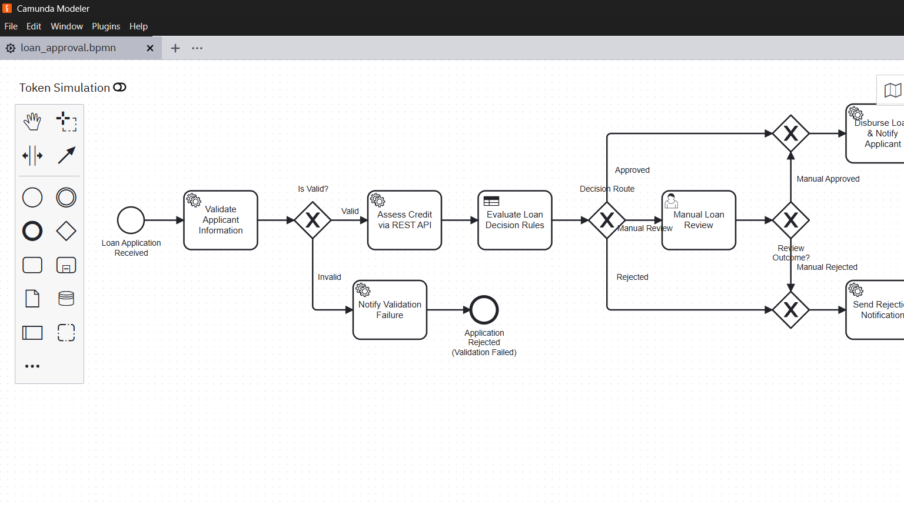
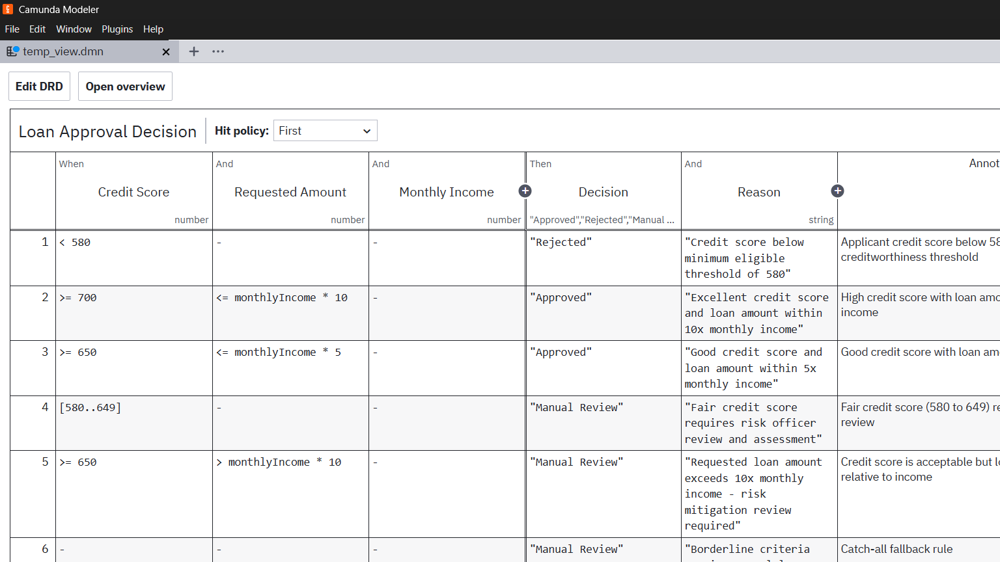

# LAB 1 Implementation Report: End-to-End Loan Approval Automation

## 1. Problem Statement & Architecture Overview
The goal of Lab 1 is to automate a resilient loan approval lifecycle combining:
- **BPMN Orchestration** (`loan_approval.bpmn`): Validates input applicant details, triggers credit-assessment REST queries, routes based on DMN outcomes, and coordinates underwriter manual reviews.
- **DMN Decision Engine** (`loan_approval_decision.dmn`): Classifies requests into `Approved`, `Rejected`, or `Manual Review` using income and credit scoring thresholds.
- **Java / Spring Boot External Job Worker** (`LoanValidationWorker.java`): Validates fields and provides incident recovery triggers.
- **Outbound REST Connector** (`io.camunda:http-json:1`): Invokes the credit assessment API.
- **Camunda Tasklist**: Facilitates human underwriter review.
- **Camunda Operate**: Tracks real-time process instances, variable modifications, and incident recovery.

---

## 2. Real Camunda Modeler Process & Decision Design Evidence

### A. BPMN 2.0 Process Diagram (Captured from Camunda Modeler v5.46.1)
The process accepts applicant parameters, passes through validation, performs external credit evaluation, executes the decision table, and conditionally routes to disbursement, human underwriter review, or rejection.



### B. DMN 1.3 Decision Table (Captured from Camunda Modeler v5.46.1)
Evaluates creditworthiness using `FIRST` hit policy across 6 documented rules.



---

## 3. Process Variables Dictionary

| Variable Name | Type | Direction / Origin | Purpose |
|---|---|---|---|
| `applicantName` | String | Input | Full legal name of the applicant |
| `applicantEmail` | String | Input | Contact email for dispatching notifications |
| `monthlyIncome` | Number | Input | Gross monthly earnings in USD |
| `requestedAmount` | Number | Input | Desired principal loan amount in USD |
| `employmentStatus`| String | Input | Employment state (`EMPLOYED`, `SELF_EMPLOYED`, etc.) |
| `isValid` | Boolean | Output (Worker) | Whether data validation checks passed |
| `validationMessage`| String | Output (Worker) | Detail description of validation outcome |
| `creditScore` | Number | Output (REST API) | Credit bureau synthetic rating score (300 to 850) |
| `creditTier` | String | Output (REST API) | Tier rating (`EXCELLENT`, `GOOD`, `FAIR`, `POOR`) |
| `decision` | String | Output (DMN) | `"Approved"`, `"Rejected"`, or `"Manual Review"` |
| `decisionReason` | String | Output (DMN) | Educational reason string generated by DMN |
| `manualReviewOutcome`| String| Tasklist Input | Underwriter resolution (`"APPROVED"` / `"REJECTED"`) |
| `reviewNotes` | String | Tasklist Input | Reviewer commentary entered in Tasklist |
| `disbursementReference`| String| Output (Worker) | Unique funds transfer identifier |

---

## 4. DMN Rules & Evaluation Logic

- **Decision ID**: `loan-approval-decision`
- **Hit Policy**: `FIRST` (Rule with highest precedence fires first)
- **Inputs**:
  - `creditScore` (number)
  - `requestedAmount` (number)
  - `monthlyIncome` (number)
- **Outputs**:
  - `decision` (string: `"Approved"`, `"Rejected"`, `"Manual Review"`)
  - `reason` (string)

### Documented Educational Rules:
1. **Rule 1 (Hard Rejection)**: `creditScore < 580` $\rightarrow$ Decision: `"Rejected"`. Rationale: Fails minimum regulatory risk threshold.
2. **Rule 2 (Prime Approval)**: `creditScore >= 700` AND `requestedAmount <= monthlyIncome * 10` $\rightarrow$ Decision: `"Approved"`. Rationale: Excellent credit profile and conservative debt-to-income ratio.
3. **Rule 3 (Standard Approval)**: `creditScore >= 650` AND `requestedAmount <= monthlyIncome * 5` $\rightarrow$ Decision: `"Approved"`. Rationale: Good credit score with low loan-to-income ratio.
4. **Rule 4 (Underwriter Review)**: `creditScore in [580..649]` $\rightarrow$ Decision: `"Manual Review"`. Rationale: Fair credit requires discretionary officer evaluation.
5. **Rule 5 (High Leverage Review)**: `creditScore >= 650` AND `requestedAmount > monthlyIncome * 10` $\rightarrow$ Decision: `"Manual Review"`. Rationale: High requested loan relative to monthly earnings.
6. **Rule 6 (Fallback)**: Catch-all `-` $\rightarrow$ Decision: `"Manual Review"`.

---

## 5. REST Connector & API Examples

### Connector Configuration (`io.camunda:http-json:1` with Element Template `io.camunda.connectors.HttpJson.v2`):
- **Implementation**: Native Camunda 8 Outbound REST Connector (No custom Java worker code is used to perform HTTP calls; Zeebe Connector Runtime directly executes the request).
- **Element Template ID**: `io.camunda.connectors.HttpJson.v2`
- **Method**: `POST`
- **URL**: `http://localhost:8080/api/credit-assessment` (and `http://localhost:8080/api/credit-check`)
- **Headers (FEEL)**:
  ```feel
  = {
    "Content-Type": "application/json",
    "Accept": "application/json"
  }
  ```
- **Request Body (FEEL)**:
  ```feel
  ={
    customerName: applicantName,
    monthlyIncome: monthlyIncome,
    loanAmount: requestedAmount,
    existingEmi: if is defined(existingEmi) then existingEmi else 0,
    tenureMonths: if is defined(tenureMonths) then tenureMonths else 36,
    creditScore: if is defined(creditScore) then creditScore else null,
    simulateApiError: if is defined(simulateApiError) then simulateApiError else false
  }
  ```
- **Result Variable**: `creditCheckResponse`

### Sample API Request:
```json
{
  "customerName": "Alice Johnson",
  "monthlyIncome": 6000,
  "loanAmount": 20000,
  "existingEmi": 500,
  "tenureMonths": 36,
  "simulateApiError": false
}
```

### Sample API Response (HTTP 200 OK):
```json
{
  "customerName": "Alice Johnson",
  "applicantName": "Alice Johnson",
  "demoScore": 750,
  "creditScore": 750,
  "creditTier": "EXCELLENT",
  "estimatedEmi": 664.29,
  "totalMonthlyEmi": 1164.29,
  "emiRatio": 19.40,
  "eligible": true,
  "decision": "ELIGIBLE",
  "message": "Meets demonstration eligibility rules",
  "status": "SUCCESS"
}
```
  "creditTier": "EXCELLENT",
  "status": "SUCCESS",
  "assessmentTimestamp": "2026-11-01T14:10:00Z"
}
```

---

## 6. Test-Case Matrix & Verification Results

| Case # | Scenario | Input Characteristics | Expected Route | Observed Outcome | Status |
|:---:|---|---|---|---|:---:|
| **1** | Approval Path | Credit: 750, Income: \$6k, Amount: \$25k | Validation $\rightarrow$ REST $\rightarrow$ DMN Rule 2 $\rightarrow$ Disburse | Disbursed & Completed | **PASS** |
| **2** | Rejection Path | Credit: 520, Income: \$3.2k, Amount: \$18k | Validation $\rightarrow$ REST $\rightarrow$ DMN Rule 1 $\rightarrow$ Notify | Notice Sent & Rejected | **PASS** |
| **3** | Manual Review | Credit: 625, Income: \$4.5k, Amount: \$30k | Validation $\rightarrow$ REST $\rightarrow$ DMN Rule 4 $\rightarrow$ Tasklist | Tasklist Created & Resolved | **PASS** |
| **4** | Credit API Error | `simulateApiError: true` | Validation $\rightarrow$ REST Connector fails | Incident (HTTP 500) in Operate | **PASS** |
| **5** | Worker Recovery | `testIncident: true` | Worker throws exception on start | Incident in Operate $\rightarrow$ Retried | **PASS** |

---

## 7. Tasklist & Operate Execution Walkthrough

1. **Human Underwriter Task Resolution (Scenario 3)**:
   - When `decision == "Manual Review"`, a user task is assigned to candidate group `loan-officers`.
   - The officer opens **Camunda Tasklist** at `http://localhost:8080/tasklist`.
   - The officer inspects `applicantName`, `requestedAmount`, `monthlyIncome`, and `creditScore`.
   - The officer inputs `manualReviewOutcome = "APPROVED"` and submits the task.
   - The workflow continues through the converging gateway to disbursement.

2. **Operate Incident Investigation & Recovery (Scenario 4 & 5)**:
   - Triggering Scenario 4 produces an immediate incident in **Camunda Operate** at `http://localhost:8080/operate` on task `Assess Credit via REST API`.
   - The operator inspects the stack trace: `HTTP 500: Credit Bureau Service Unavailable`.
   - In Operate's variable editor, the operator corrects `simulateApiError` from `true` to `false`.
   - The operator clicks **Retry Incident**. The task completes without restarting the process, demonstrating full recovery.

---

## 8. Limitations & Assumptions
- **Credit Assessment Simulation**: Credit scoring relies on synthetic mock endpoints; production environments require OAuth2 / mTLS authentication against real credit bureau APIs (Experian, Equifax).
- **Idempotency**: Disbursement service tasks should include an external idempotency key header to prevent duplicate ACH transfers in case of network retry events.

