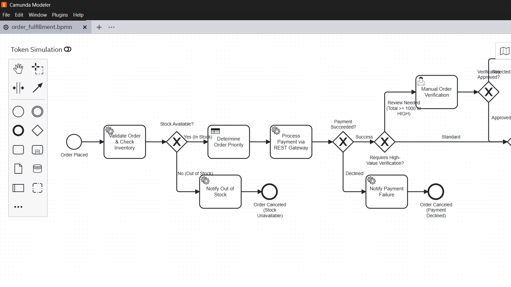
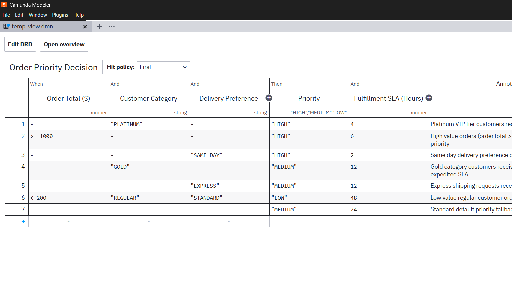

# LAB 2 Implementation Report: End-to-End E-Commerce Order Processing and Fulfilment

## 1. Problem Statement & Architecture Overview
Lab 2 automates a resilient e-commerce order fulfillment pipeline:
- **BPMN Orchestration** (`order_fulfillment.bpmn`): Validates incoming orders, performs inventory reservation checks, evaluates order priority via DMN, invokes a payment gateway via REST, routes high-value orders for verification, and triggers dispatch.
- **DMN Decision Engine** (`order_priority.dmn`): Classifies order priority (`HIGH`, `MEDIUM`, `LOW`) and sets delivery SLAs based on order total, customer loyalty tier, and shipping speed preference.
- **Java / Spring Boot External Workers** (`OrderInventoryWorker.java`, `OrderFulfillmentWorker.java`): Validates stock levels, calculates totals, and manages warehouse dispatch.
- **REST Connector** (`io.camunda:http-json:1`): Calls the simulated payment gateway service.
- **Camunda Tasklist**: Facilitates human intervention for high-value orders.
- **Camunda Operate**: Provides monitoring, incident detection, and recovery.

---

## 2. Real Camunda Modeler Process & Decision Design Evidence

### A. BPMN 2.0 Process Diagram (Captured from Camunda Modeler v5.46.1)
The workflow coordinates sequential gateways to validate stock availability, evaluate priority, process payment, and intercept high-value or high-priority orders for supervisor approval.



### B. DMN 1.3 Decision Table (Captured from Camunda Modeler v5.46.1)
Evaluates order priority and fulfillment turnaround SLAs using `FIRST` hit policy across 7 educational rules.



---

## 3. Process Variables Dictionary

| Variable Name | Type | Direction / Origin | Purpose |
|---|---|---|---|
| `orderId` | String | Input | Unique sales order tracking number (e.g. `ORD-1001`) |
| `customerReference`| String | Input | Customer account ID |
| `productId` | String | Input | SKU product code |
| `quantity` | Number | Input | Count of units ordered |
| `unitPrice` | Number | Input | Price per individual unit in USD |
| `deliveryPreference`| String| Input | `"STANDARD"`, `"EXPRESS"`, or `"SAME_DAY"` |
| `customerCategory` | String | Input | Loyalty tier: `"PLATINUM"`, `"GOLD"`, `"REGULAR"` |
| `paymentToken` | String | Input | Simulated token for card payment authorization |
| `orderTotal` | Number | Output (Worker) | Computed total price: `quantity * unitPrice` |
| `stockAvailable` | Boolean| Output (Worker) | Warehouse inventory availability flag |
| `stockQuantity` | Number | Output (Worker) | Remaining stock in fulfillment center |
| `priority` | String | Output (DMN) | Priority level: `"HIGH"`, `"MEDIUM"`, `"LOW"` |
| `slaHours` | Number | Output (DMN) | Fulfillment SLA target commitment window |
| `paymentStatus` | String | Output (REST API) | `"SUCCESS"`, `"DECLINED"`, or `"FAILED"` |
| `transactionId` | String | Output (REST API) | Payment gateway authorization ID |
| `orderVerified` | Boolean| Tasklist Input | Ops specialist manual order approval decision |
| `trackingNumber` | String | Output (Worker) | Shipping carrier tracking code |

---

## 4. DMN Rules & Routing Explanation

- **Decision ID**: `order-priority-decision`
- **Hit Policy**: `FIRST`
- **Inputs**: `orderTotal` (number), `customerCategory` (string), `deliveryPreference` (string)
- **Outputs**: `priority` (string), `slaHours` (number)

### Documented Priority Rules:
1. **Rule P1 (VIP Platinum Tier)**: Customer is `"PLATINUM"` $\rightarrow$ Priority: `"HIGH"`, SLA: `4` hours.
2. **Rule P2 (High Value Order)**: `orderTotal >= 1000` $\rightarrow$ Priority: `"HIGH"`, SLA: `6` hours.
3. **Rule P3 (Same Day Urgency)**: Delivery is `"SAME_DAY"` $\rightarrow$ Priority: `"HIGH"`, SLA: `2` hours.
4. **Rule P4 (Gold Tier Customer)**: Customer is `"GOLD"` $\rightarrow$ Priority: `"MEDIUM"`, SLA: `12` hours.
5. **Rule P5 (Express Shipping)**: Delivery is `"EXPRESS"` $\rightarrow$ Priority: `"MEDIUM"`, SLA: `12` hours.
6. **Rule P6 (Low-Value Economy)**: `orderTotal < 200` AND `"REGULAR"` AND `"STANDARD"` $\rightarrow$ Priority: `"LOW"`, SLA: `48` hours.
7. **Rule P7 (Default Fallback)**: All other orders $\rightarrow$ Priority: `"MEDIUM"`, SLA: `24` hours.

### Gateway Routing Rules:
- **Gateway 1 (`Gateway_StockCheck`)**:
  - `stockAvailable == true`: Continues to DMN priority assessment.
  - `stockAvailable == false`: Diverts to `Task_NotifyOutOfStock` and ends with cancellation.
- **Gateway 2 (`Gateway_PaymentOutcome`)**:
  - `paymentStatus == "SUCCESS"`: Continues to high-value review check.
  - `paymentStatus != "SUCCESS"`: Diverts to `Task_NotifyPaymentDeclined` and terminates.
- **Gateway 3 (`Gateway_NeedsReview`)**:
  - `orderTotal >= 1000 or priority == "HIGH"`: Diverts to `Task_ManualOrderVerification` (Tasklist).
  - Else: Proceeds directly to `Task_FulfillOrder`.

---

## 5. REST Connector Configuration & API Examples

### Connector Configuration (`io.camunda:http-json:1`):
- **Method**: `POST`
- **URL**: `http://localhost:8080/api/payment/charge`
- **Request Body (FEEL)**:
  ```feel
  ={
    orderId: orderId,
    amount: orderTotal,
    paymentToken: paymentToken,
    testIncident: testIncident,
    simulatePaymentDecline: simulatePaymentDecline
  }
  ```

### Sample Payment Request:
```json
{
  "orderId": "ORD-1001",
  "amount": 85.0,
  "paymentToken": "tok_visa_valid_9981"
}
```

### Sample Payment Response:
```json
{
  "orderId": "ORD-1001",
  "amount": 85.0,
  "paymentStatus": "SUCCESS",
  "transactionId": "TXN-8A2F99B12C",
  "chargedAt": "2026-11-01T14:12:00Z"
}
```

---

## 6. Test-Case Matrix & Verification Results

| Case # | Scenario | Inputs | Evaluated Rule | Gateway Route | Final Result |
|:---:|---|---|---|---|:---:|
| **1** | Normal Fulfilled | Total: \$85, Regular, Standard | Rule P6 (Low, 48h) | Stock OK $\rightarrow$ Pay OK $\rightarrow$ Standard | **SHIPPED** |
| **2** | Stock Insufficient | 50 units, `simulateStockOut: true` | N/A | Stock Out $\rightarrow$ Notify | **CANCELED** |
| **3** | Payment Declined | Token: `tok_declined_card_0000` | Rule P4 (Med, 12h) | Stock OK $\rightarrow$ Payment Declined | **CANCELED** |
| **4** | High-Value Review | Total: \$3,200, Platinum | Rule P1 (High, 4h) | Stock OK $\rightarrow$ Pay OK $\rightarrow$ User Task | **VERIFIED & SHIPPED** |
| **5** | Gateway Outage | `testIncident: true` | Rule P4 (Med, 12h) | Payment Connector 503 Outage | **INCIDENT & RECOVERED** |

---

## 7. Tasklist & Operate Execution Walkthrough

1. **Manual Order Verification in Tasklist (Scenario 4)**:
   - For order `ORD-1004` (\$3,200 total), the workflow initiates a task assigned to candidate group `sales-ops`.
   - The sales operations agent opens **Tasklist** at `http://localhost:8080/tasklist`.
   - The agent verifies customer creditworthiness and sets `orderVerified = true`.
   - Upon completion, the process converges to `Task_FulfillOrder` and marks the item shipped.

2. **Operate Incident Investigation & Recovery (Scenario 5)**:
   - Starting an instance with `testIncident: true` induces an intentional HTTP 503 error on the payment connector.
   - The incident appears highlighted in red inside **Camunda Operate** at `http://localhost:8080/operate`.
   - The administrator verifies the error in Operate: `Payment Gateway Outage - Connection Timeout`.
   - The administrator resolves the endpoint mock service, toggles `testIncident` to `false` in Operate, and clicks **Retry Incident**.
   - The instance resumes and completes dispatch without data loss.

---

## 8. Limitations & Assumptions
- **Inventory Concurrency**: Warehouse stock checks are simulated in-memory; enterprise deployments must integrate distributed locking (e.g. Redis Redlock) to prevent inventory overselling during concurrent checkouts.
- **PCI-DSS Compliance**: Process variables only store one-time synthetic payment tokens rather than raw credit card numbers.

