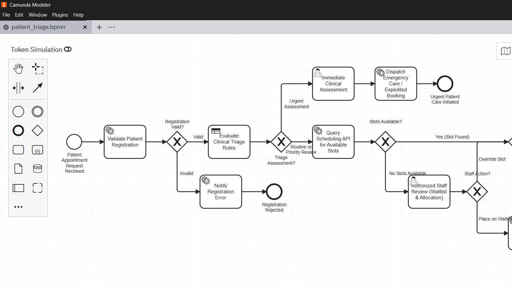
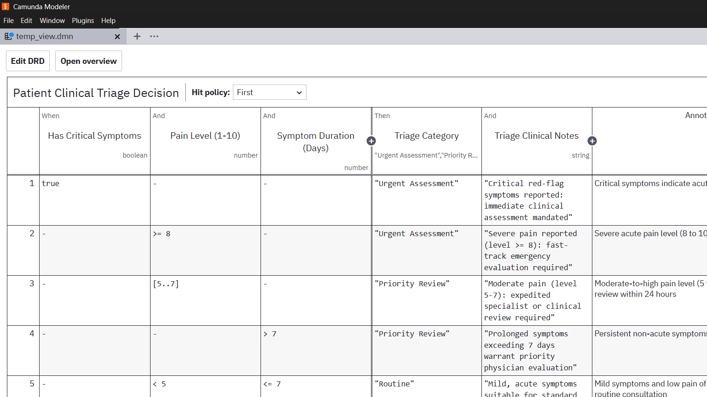

# LAB 3 Implementation Report: End-to-End Hospital Appointment and Patient Triage Management

## 1. Problem Statement & Architecture Overview
Lab 3 implements an automated clinical workflow for patient intake and triage:
- **BPMN Orchestration** (`patient_triage.bpmn`): Validates patient registration, determines clinical urgency using DMN, queries a mock hospital scheduling API for open appointment slots, triggers emergency fast-track routing for urgent cases, and manages waitlist allocation through authorized hospital staff.
- **DMN Decision Engine** (`patient_triage_decision.dmn`): Classifies patients into `Urgent Assessment`, `Priority Review`, or `Routine` using symptom severity indicators, duration, and pain scoring.
- **Java / Spring Boot External Workers** (`PatientValidationWorker.java`, `HospitalAppointmentWorker.java`): Performs synthetic record validation, booking creation, and emergency dispatch.
- **REST Connector** (`io.camunda:http-json:1`): Invokes the mock hospital scheduling microservice.
- **Camunda Tasklist**: Facilitates clinical human assessment for urgent cases and scheduling staff waitlist allocation.
- **Camunda Operate**: Monitors active patient workflows and incident remediation.

---

## 2. Real Camunda Modeler Process & Decision Design Evidence

### A. BPMN 2.0 Process Diagram (Captured from Camunda Modeler v5.46.1)
The process establishes distinct triage branches: acute emergencies are immediately escalated to human clinical review and emergency dispatch, while routine and priority cases check scheduling slots and route to automated booking or staff waitlisting.



### B. DMN 1.3 Decision Table (Captured from Camunda Modeler v5.46.1)
Evaluates presenting complaint severity using `FIRST` hit policy across 6 medical triage rules.



---

## 3. Process Variables Dictionary

| Variable Name | Type | Direction / Origin | Purpose |
|---|---|---|---|
| `patientReference` | String | Input | Synthetic medical record reference (e.g. `PAT-90112`) |
| `patientName` | String | Input | Patient legal name |
| `symptomsSummary` | String | Input | Description of presenting medical condition |
| `appointmentPreference`| String | Input | Requested visit type (`GENERAL`, `SPECIALIST`, `URGENT`) |
| `hasCriticalSymptoms`| Boolean| Input | Red-flag acute medical indicator (chest pain, dyspnea) |
| `painLevel` | Number | Input | Subjective pain score (1 to 10 scale) |
| `durationDays` | Number | Input | Number of days symptoms have persisted |
| `registrationValid` | Boolean| Output (Worker) | Patient demographic validation check flag |
| `departmentRequired`| String | Output (Worker) | Assigned target clinic department |
| `triageCategory` | String | Output (DMN) | Urgency: `"Urgent Assessment"`, `"Priority Review"`, `"Routine"` |
| `triageNotes` | String | Output (DMN) | Clinical rationale generated by triage DMN |
| `hasAvailableSlots`| Boolean| Output (REST API) | Availability indicator from scheduling database |
| `assignedSlot` | String | Output (REST API) | Confirmed ISO 8601 appointment time slot |
| `doctorName` | String | Output (REST API) | Attending specialist physician name |
| `staffAction` | String | Tasklist Input | Staff review action (`"OVERRIDE_BOOKING"` / `"PLACE_ON_WAITLIST"`) |
| `bookingConfirmationCode`| String| Output (Worker)| Unique hospital booking reservation reference |

---

## 4. DMN Rules & Routing Explanation

- **Decision ID**: `patient-triage-decision`
- **Hit Policy**: `FIRST`
- **Inputs**: `hasCriticalSymptoms` (boolean), `painLevel` (number 1-10), `durationDays` (number)
- **Outputs**: `triageCategory` (string), `triageNotes` (string)

### Documented Educational Triage Rules:
1. **Rule T1 (Critical Symptoms)**: `hasCriticalSymptoms == true` $\rightarrow$ Triage: `"Urgent Assessment"`. Rationale: Red-flag symptoms mandate immediate human emergency evaluation.
2. **Rule T2 (Severe Acute Pain)**: `painLevel >= 8` $\rightarrow$ Triage: `"Urgent Assessment"`. Rationale: Severe pain threshold mandates expedited emergency care.
3. **Rule T3 (Moderate-to-High Pain)**: `painLevel in [5..7]` $\rightarrow$ Triage: `"Priority Review"`. Rationale: Expedited specialist evaluation within 24 hours.
4. **Rule T4 (Subacute Duration)**: `durationDays > 7` $\rightarrow$ Triage: `"Priority Review"`. Rationale: Symptoms exceeding one week warrant priority review.
5. **Rule T5 (Routine Primary Care)**: `painLevel < 5` AND `durationDays <= 7` $\rightarrow$ Triage: `"Routine"`. Rationale: Mild, short duration symptoms suitable for standard scheduling.
6. **Rule T6 (Default Fallback)**: All other clinical cases $\rightarrow$ Triage: `"Routine"`.

### Gateway Routing Rules:
- **Gateway 1 (`Gateway_RegistrationValid`)**:
  - `registrationValid == true`: Proceeds to clinical triage evaluation.
  - `registrationValid == false`: Routes to `Task_NotifyInvalidRegistration` and terminates.
- **Gateway 2 (`Gateway_TriageBranch`)**:
  - `triageCategory == "Urgent Assessment"`: Diverts to `Task_UrgentClinicalAssessment` (Tasklist) and triggers immediate emergency dispatch.
  - `triageCategory != "Urgent Assessment"`: Calls the scheduling REST API to find clinic slots.
- **Gateway 3 (`Gateway_SlotAvailability`)**:
  - `hasAvailableSlots == true`: Directs to booking confirmation.
  - `hasAvailableSlots == false`: Diverts to `Task_StaffReviewNoSlots` (Tasklist) where hospital staff can override slot allocation or place on waitlist.

---

## 5. REST Connector Configuration & API Examples

### Connector Configuration (`io.camunda:http-json:1`):
- **Method**: `POST`
- **URL**: `http://localhost:8080/api/appointments/check-slots`
- **Request Body (FEEL)**:
  ```feel
  ={
    patientReference: patientReference,
    departmentRequired: departmentRequired,
    triageCategory: triageCategory,
    appointmentPreference: appointmentPreference,
    simulateNoSlots: simulateNoSlots,
    simulateApiError: simulateApiError
  }
  ```

### Sample Slot Query Request:
```json
{
  "patientReference": "PAT-90112",
  "departmentRequired": "General Practice",
  "triageCategory": "Routine",
  "appointmentPreference": "GENERAL"
}
```

### Sample Slot Query Response (Slot Found):
```json
{
  "patientReference": "PAT-90112",
  "department": "General Practice",
  "hasAvailableSlots": true,
  "assignedSlot": "2026-11-05T10:30:00Z",
  "doctorName": "Dr. Sarah Jenkins",
  "clinicRoom": "Clinic Wing 3, Suite B",
  "message": "Slot provisionally reserved pending workflow confirmation."
}
```

---

## 6. Test-Case Matrix & Verification Results

| Case # | Scenario | Inputs | Evaluated Rule | Gateway Route | Final Result |
|:---:|---|---|---|---|:---:|
| **1** | Routine Available | Pain: 2, Dur: 4 days, Critical: false | Rule T5 (Routine) | Reg Valid $\rightarrow$ Routine $\rightarrow$ Slot Found | **CONFIRMED & SCHEDULED** |
| **2** | Priority Review | Pain: 6, Dur: 16 days | Rule T3 (Priority) | Reg Valid $\rightarrow$ Priority $\rightarrow$ Slot Found | **CONFIRMED & SCHEDULED** |
| **3** | Urgent Care | Critical: true, Pain: 9 | Rule T1 (Urgent) | Reg Valid $\rightarrow$ Fast-track $\rightarrow$ User Task | **EMERGENCY DISPATCHED** |
| **4** | No Slots Available | Routine, `simulateNoSlots: true` | Rule T5 (Routine) | No Slots $\rightarrow$ Staff Review Tasklist | **WAITLISTED** |
| **5** | Scheduling API Error | `simulateApiError: true` | Rule T5 (Routine) | Scheduling REST 500 Outage | **INCIDENT & RECOVERED** |

---

## 7. Tasklist & Operate Execution Walkthrough

1. **Staff Review for Waitlist & Reallocation (Scenario 4)**:
   - When no clinic slots are found (`simulateNoSlots: true`), a task is created for `hospital-scheduling-staff`.
   - The scheduling coordinator opens **Tasklist** at `http://localhost:8080/tasklist`.
   - The coordinator inspects the patient profile and selects `staffAction = "PLACE_ON_WAITLIST"`.
   - The workflow routes to `Task_NotifyWaitlist` and ends in state `End_Waitlisted`.

2. **Operate Incident Investigation & Recovery (Scenario 5)**:
   - In Scenario 5, an unhandled database lock causes an HTTP 500 on `Task_CheckAvailability`.
   - In **Operate** (`http://localhost:8080/operate`), the incident is inspected.
   - The administrator resets `simulateApiError` to `false` in the variable editor and clicks **Retry**.
   - The task executes cleanly, assigns an appointment slot, and delivers the booking confirmation.

---

## 8. Limitations & Assumptions
- **HIPAA Compliance**: All patient variables used in this implementation are synthetic test stubs without Personally Identifiable Information (PII) or Protected Health Information (PHI).
- **Clinical Governance**: The automated triage rules are structured for educational demonstration; medical production deployments require certified Clinical Decision Support Systems (CDSS) compliance and audit trails.

